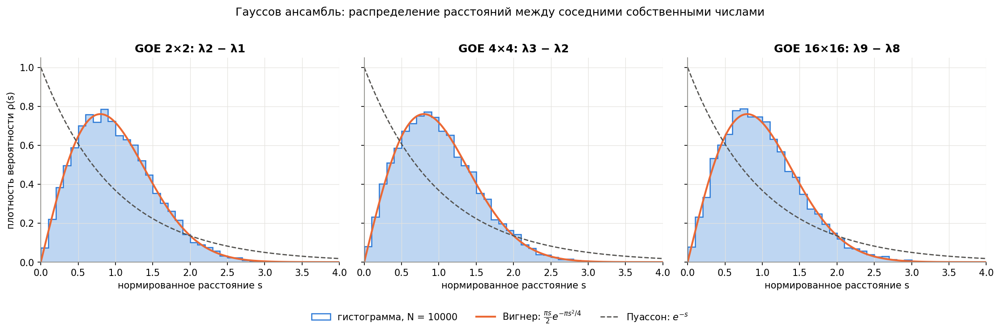
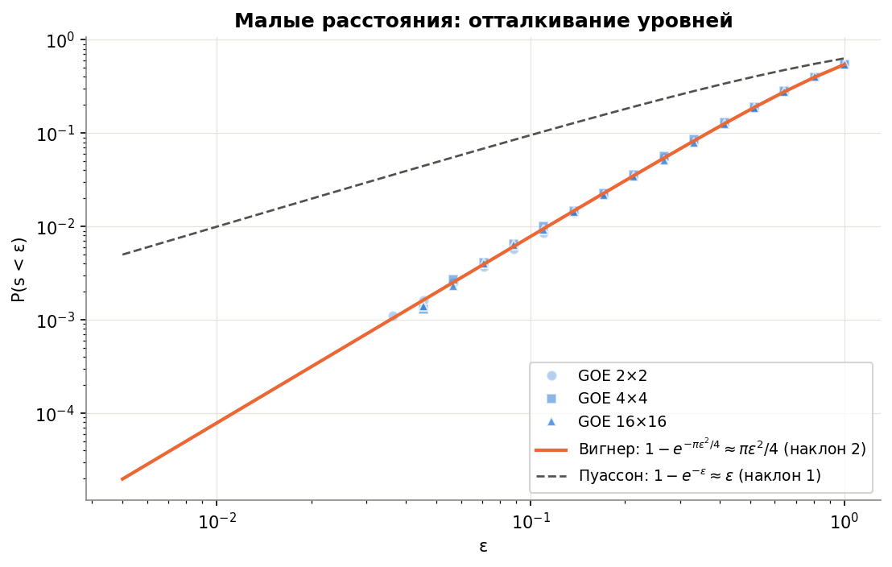
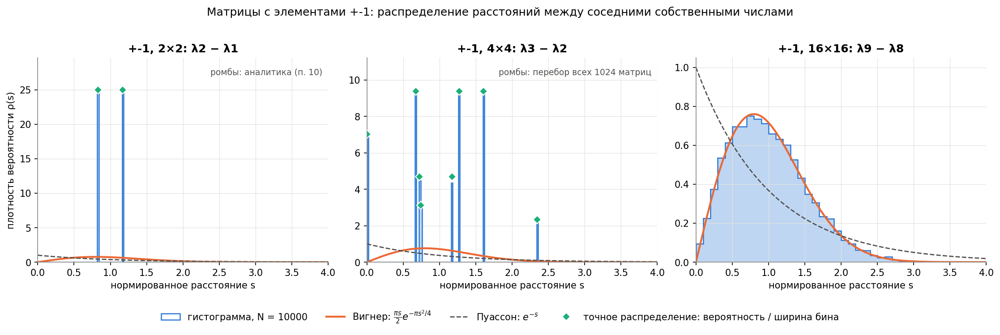

# Лабораторная работа 2
## Свойства случайных матриц: распределение расстояний между собственными числами

### Запуск

Требуется Python 3.10+, NumPy 2.x и Matplotlib.
Из папки `Lab2`:

```powershell
python -m unittest discover -s tests -v
```

### Состав

```text
Lab2/
├── Lab2.ipynb               # отчёт с выполненными ячейками
├── rmt.py                   # ансамбли, спектры, расстояния, теория, меры согласия
├── tests/test_rmt.py        # автоматические тесты модуля
├── figures/                 # графики
└── README.md
```

### Методика

1. Ансамбли по **N = 10 000** матриц размеров 2×2, 4×4, 16×16 (задание требует ≥ 1000).
2. Гауссов ансамбль — по формуле (8): `B = A + Aᵀ`, `A_ij ~ N(0, 1)`.
   Ансамбль +-1 — симметричная матрица, все элементы которой равны +-1 с вероятностью 1/2.
3. Спектры — `numpy.linalg.eigvalsh`; первые 1000 матриц каждого ансамбля перепроверены
   методом Якоби (расхождение <= 3·10^(-14)).
4. Фиксированная пара: центральная, `λ₂−λ₁`, `λ₃−λ₂`, `λ₉−λ₈`; расстояния делятся на среднее.
5. Согласие с догадкой Вигнера оценивается дисперсией (теория 4/π − 1 ≈ 0.273),
   долей P(s < 0.1) (теория 0.0078), статистикой Колмогорова–Смирнова
   (порог 1.36/√N ≈ 0.0136) и расхождением Кульбака–Лейблера по бинам.

### Результаты



| Ансамбль | n | D[s] | P(s<0.1) | P(s=0) | KS (Вигнер) | KL (Вигнер) |
|---|---|---|---|---|---|---|
| Гауссов | 2 | 0.272 | 0.0074 | 0 | 0.0076 | 0.002 |
| Гауссов | 4 | 0.278 | 0.0080 | 0 | 0.0057 | 0.002 |
| Гауссов | 16 | 0.281 | 0.0078 | 0 | 0.0104 | 0.003 |
| +-1 | 2 | 0.029 | 0 | 0 | 0.418 | 1.97 |
| +-1 | 4 | 0.348 | 0.143 | 0.143 | 0.176 | 1.42 |
| +-1 | 16 | 0.280 | 0.0095 | 0.0001 | 0.0094 | 0.002 |
| **Вигнер** | | **0.273** | **0.0078** | **0** | | |





### Выводы

- **Гауссов ансамбль:** для всех размеров гистограмма совпадает с догадкой в пределах
  статистической погрешности. Для 2×2 формула точна; среднее до нормировки 3.546 при
  теоретическом 2√π ≈ 3.545.
- **Вблизи нуля (п. 6):** плотность растёт линейно, P(s < ε) ≈ πε²/4 (наклон 1.9–2.05 в
  логарифмическом масштабе). Это **отталкивание уровней**: для вырождения нужно, чтобы
  одновременно обратились в ноль две независимые непрерывные величины (b и d),
  то есть вырожденные матрицы образуют множество коразмерности 2.
- **Матрицы +-1, 2×2:** s = √((c−a)² + 4) принимает значения 2 и 2√2 с вероятностью 1/2,
  ⟨s⟩ = 1 + √2; после нормировки ρ(s) = 1/2*δ(s − 2(√2−1)) + 1/2*δ(s − (4−2√2)), D[s] = 17 − 12√2 ≈ 0.029.
  Для варианта A + Aᵀ: s = 0, 4, 4√2 с вероятностями ¼, ½, ¼.
- **Матрицы +-1, 4×4:** перебор всех 1024 матриц даёт 8 значений; с вероятностью ровно 9/64
  уровни вырождены. Для дискретных элементов отталкивания нет.
- **Матрицы +-1, 16×16:** статистика неотличима от гауссовой — проявление **универсальности**
  локальной статистики спектров случайных матриц.
- Фиксация пары существенна: если смешать все пары 16×16, дисперсия растёт до 0.33, а KS выходит за порог.
