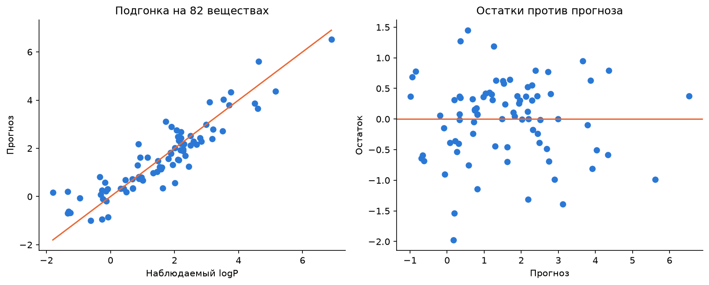

# Липофильность молекул: линейная регрессия

Лабораторная работа 3. Модель предсказывает `logP` по 24 молекулярным дескрипторам.
Метод наименьших квадратов реализован решением нормальных уравнений на NumPy.
В отчёте приведены коэффициенты, остатки, дисперсия ошибки, R² и t-интервалы.

[Отчёт](Lab3.ipynb) · [Задание](lab3.pdf) · [Код](regression.py) · [Данные](lipo.csv) · [Результаты](results/)

## Содержание

- [Запуск](#запуск)
- [Данные](#данные)
- [Методика](#методика)
- [Результаты](#результаты)
- [Пример использования](#пример-использования)
- [Файлы](#файлы)
- [Проверки и ограничения](#проверки-и-ограничения)

## Запуск

Требуется Python 3.10 или новее. Установка из корня проекта в PowerShell:

```powershell
python -m venv .venv
.\.venv\Scripts\python.exe -m pip install -r Lab3/requirements.txt
.\.venv\Scripts\python.exe run_labs.py 3
```

В Linux / macOS используются `python3` для создания окружения и
`./.venv/bin/python` для установки зависимостей и выполнения скрипта.
Скрипт обновляет выводы ноутбука, таблицы `results/` и графики `figures/`.

Для интерактивного выполнения [ноутбук](Lab3.ipynb) открывается в VS Code или Jupyter;
выбирается ядро Python из `.venv`, затем ячейки выполняются сверху вниз.
Рабочим каталогом может быть корень проекта или папка `Lab3`.

Папка `Lab3` также может использоваться отдельно: зависимости устанавливаются
из её `requirements.txt`, ноутбук запускается с рабочим каталогом в этой папке.
Внешние результаты для расчётов не требуются.

## Данные

Загрузчик по умолчанию читает **[lipo.csv](lipo.csv) рядом с `regression.py`**,
независимо от рабочего каталога.

| Поле | Содержание |
|---|---|
| Первый столбец | Название вещества |
| `logP` | Цель в исходной шкале CSV, без повторного логарифмирования |
| Остальные столбцы | 24 дескриптора в порядке `FEATURES` |
| Число наблюдений | 82 |

Проверяются число и порядок столбцов, пропуски и конечность числовых значений.
Описательные статистики представлены в `results/data_summary.csv`.

## Методика

| Часть | Расчёт |
|---|---|
| МНК | Решение `(A.T @ A) @ b = A.T @ y`, где `A = [1, X]` |
| Остатки | `e = y - A @ b` |
| Дисперсия ошибки | `s² = (e.T @ e) / (n - K)`, `s = sqrt(s²)` |
| Коэффициент детерминации | `R² = 1 - SSE / sum((y - mean(y))²)` |
| t-интервалы | `b ± t(0.975, n-K) * SE` |
| Предпосылки | Обсуждение ранга, экзогенности, дисперсии и нормальности ошибок |

Матрица имеет полный ранг 25; остаточных степеней свободы — 57.
Ковариация коэффициентов вычисляется как `s² * (A.T @ A)^(-1)`.
Для оценки вклада признака используется прямое следствие линейного уравнения:
изменение прогноза `b_j * (max(x_j) - min(x_j))` при фиксированных остальных входах.
Сопоставление со статьёй, указанной в задании, выполнено по R², RMSE и `s`.

## Результаты

| Показатель на исходной выборке | Значение |
|---|---:|
| SSE | 33.684934 |
| s² | 0.590964 |
| s | 0.768742 |
| RMSE | 0.640930 |
| R² | 0.837989 |



RMSE определяется как `sqrt(SSE / n)` и отличается от стандартной ошибки регрессии `s`.
Все значения относятся к подгонке на исходной выборке; точность на новых веществах не оценивалась.

## Пример использования

Из корня проекта:

```python
from Lab3.regression import FEATURES, load_data, fit_ols, metrics

frame = load_data()
x = frame[FEATURES].to_numpy(dtype=float)
y = frame['logP'].to_numpy(dtype=float)
model = fit_ols(x, y)
print(metrics(y, model.fitted))
print(model.coefficients(FEATURES))
```

При работе непосредственно в папке `Lab3` строка импорта имеет вид
`from regression import FEATURES, load_data, fit_ols, metrics`.

## Файлы

```text
Lab3/
├── Lab3.ipynb
├── lab3.pdf
├── lipo.csv
├── regression.py
├── requirements.txt
├── README.md
├── tests/test_regression.py
├── test-results.txt
├── figures/
│   ├── coefficients.png
│   └── diagnostics.png
└── results/
    ├── data_summary.csv
    ├── coefficients.csv
    ├── residuals.csv
    ├── summary.json
    ├── feature_effects.csv
    └── article_comparison.csv
```

## Проверки и ограничения

Из корня проекта:

```powershell
.\.venv\Scripts\python.exe -m unittest discover -s Lab3/tests -v
```

Из папки `Lab3`: `python -m unittest discover -s tests -v` в окружении с установленными зависимостями.
Три теста проверяют известное аналитическое решение, ковариацию и t-интервалы,
загрузку локального CSV, нормальные уравнения и обработку некорректных данных.

Полный ранг не исключает сильную корреляцию признаков. Условия экзогенности,
независимости и постоянства дисперсии истинных ошибок по CSV не установлены.
Нормальность ошибок для t-интервалов принимается условно. Нулевые сумма остатков
и `A.T @ e` являются следствием МНК, а не доказательством этих предпосылок.
