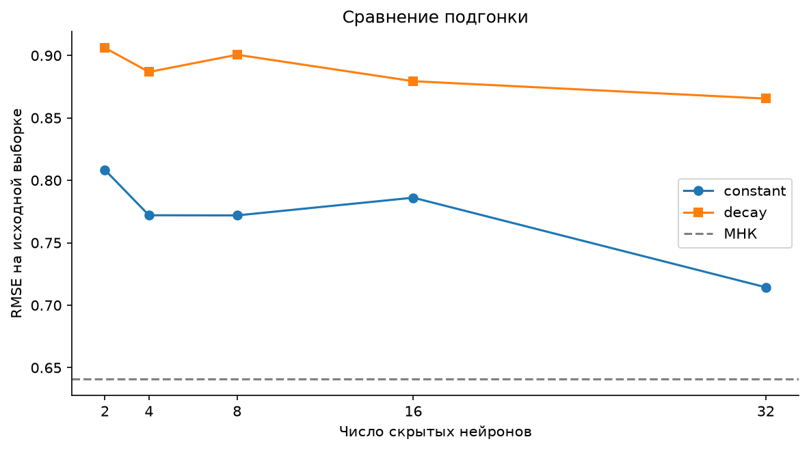

# Липофильность молекул: двухслойный перцептрон

Лабораторная работа 4. Двухслойный ReLU-перцептрон предсказывает `logP`
по 24 дескрипторам. Прямой проход, производные суммы квадратов ошибок и градиентный спуск реализованы на NumPy.

[Отчёт](Lab4.ipynb) · [Задание](lab4.pdf) · [Код](perceptron.py) · [Данные](lipo.csv) · [Результаты](results/)

## Запуск

Требуется Python 3.10 или новее. Команды из корня проекта в PowerShell:

```powershell
python -m venv .venv
.\.venv\Scripts\python.exe -m pip install -r Lab4/requirements.txt
.\.venv\Scripts\python.exe run_labs.py 4
```

В Linux / macOS используются `python3` для создания окружения и
`./.venv/bin/python` для остальных команд.
Скрипт обновляет выводы ноутбука, таблицы, графики и все десять моделей.
Для интерактивного выполнения выбирается ядро `.venv` в VS Code или Jupyter.
Рабочим каталогом может быть корень проекта или папка `Lab4`.

Данные загружаются из локального `Lab4/lipo.csv`.
Из [Lab3/regression.py](../Lab3/regression.py) используются загрузчик, метрики
и нормальные уравнения для сравнения с МНК. Результаты МНК вычисляются заново;
сохранённые таблицы и выполненный ноутбук Lab3 для запуска не требуются.

## Методика

```text
24 исходных признака → скрытый слой ReLU → линейный выход → logP
```

| Параметр | Значение |
|---|---|
| Скрытых нейронов | 2, 4, 8, 16, 32 |
| Число параметров | 53, 105, 209, 417, 833 |
| Функция потерь J | Сумма квадратов ошибок |
| Начальная скорость ε | 0.000001 |
| Точность δ | 0.001 |
| Критерий остановки | `max(abs(gradient J)) < δ` |
| Лимит | 30 000 обновлений |
| Убывающий шаг | `ε / (1 + k / 1000)` |
| Начальные веса | Равномерно из `[-0.1, 0.1]`, смещения нулевые |
| Seed | 2026 |
| Условное значение для расчёта градиента ReLU в нуле | 1 |

Признаки и цель не стандартизуются. Малый шаг соответствует масштабу исходных входов
и сумме квадратов в функции потерь. Парные эксперименты с постоянным и убывающим
шагом начинаются с одинаковых весов.

В нуле ReLU не имеет классической производной. Значение 1 принято как соглашение
для вычисления градиента; вне нуля используются 0 при отрицательном входе и 1 при положительном.

Сравнение с `MLPRegressor` предусмотрено заданием. Для библиотечной потери `J/(2n)`
используется шаг `2nε`, чтобы учесть нормировку градиента. Инициализации различаются.
Вклад признаков оценивается прямым пересчётом прогноза при изменении одного входа
от минимума до максимума; остальные входы фиксируются на средних значениях.

## Результаты

RMSE на исходной выборке, в единицах `logP`:

| Нейронов | Постоянный шаг | Убывающий шаг |
|---:|---:|---:|
| 2 | 0.808359 | 0.906072 |
| 4 | 0.772033 | 0.886780 |
| 8 | 0.771920 | 0.900569 |
| 16 | 0.786103 | 0.879377 |
| 32 | 0.714368 | 0.865456 |

Для МНК RMSE равна **0.64093**. Все десять собственных запусков завершились
по лимиту 30 000 обновлений без достижения δ. При выбранных параметрах сети
уступили МНК по обучающей ошибке. Это не доказывает превосходства линейной
архитектуры при других начальных весах и бюджете обучения.

Актуальные результаты сохранены в таблицах после выполнения ноутбука:

| Файл | Содержание |
|---|---|
| [training.csv](results/training.csv) | Ошибки, число обновлений, норма градиента и сходимость всех десяти запусков |
| [settings.json](results/settings.json) | Параметры эксперимента |
| `results/history_h{h}_{schedule}.csv` | Истории суммы квадратов, градиента и шага |
| [sklearn_comparison.csv](results/sklearn_comparison.csv) | Пять библиотечных моделей |
| [model_comparison.csv](results/model_comparison.csv) | Сети и МНК на исходной выборке |
| [feature_effects.csv](results/feature_effects.csv) | Изменения прямого прогноза для сети `h=8, constant` и МНК |
| [predictions_h8.csv](results/predictions_h8.csv) | Прогнозы сети `h=8, constant` |
| [models/](models/) | Десять наборов весов NPZ |



Все показатели относятся к исходной выборке. Точность на новых веществах здесь не проверялась. Достижение лимита итераций не означает выполнения точности δ.

## Использование весов

Пример из корня проекта:

```python
from pathlib import Path
from Lab3.regression import FEATURES, load_data
from Lab4.perceptron import predict_saved

frame = load_data(Path('Lab4/lipo.csv'))
x = frame[FEATURES].to_numpy(dtype=float)
prediction = predict_saved('Lab4/models/mlp_h8_constant.npz', x)
print(prediction[:5])
```

Каждый архив содержит `w1`, `b1`, `w2`, `b2`. На вход подаются 24 признака
в порядке `FEATURES`, в исходных единицах. Выход возвращается в шкале `logP` из CSV.

## Структура

```text
Lab4/
├── Lab4.ipynb
├── lab4.pdf
├── lipo.csv
├── perceptron.py
├── requirements.txt
├── README.md
├── tests/test_perceptron.py
├── test-results.txt
├── models/
├── figures/
│   ├── learning_curves.png
│   ├── model_comparison.png
│   └── feature_effects.png
└── results/
```

## Проверки и ограничения

Из корня проекта:

```powershell
.\.venv\Scripts\python.exe -m unittest discover -s Lab4/tests -v
```

Шесть тестов проверяют производные на примере с известным ответом, значение H(0),
один шаг спуска, убывание шага, остановку в известном решении, обучение простой функции,
воспроизводимость, сохранение весов и обработку ошибочных параметров.

Малая обучающая ошибка не гарантирует точного прогноза новых молекул.
Число параметров начиная с четырёх нейронов превышает число наблюдений.
Градиентный спуск зависит от начальных весов и может не достичь точности за отведённый лимит.
Изменение одного входа при фиксированных остальных описывает поведение конкретной модели;
оно не устанавливает физическую причинность.
