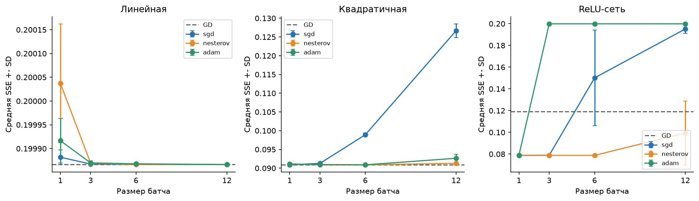
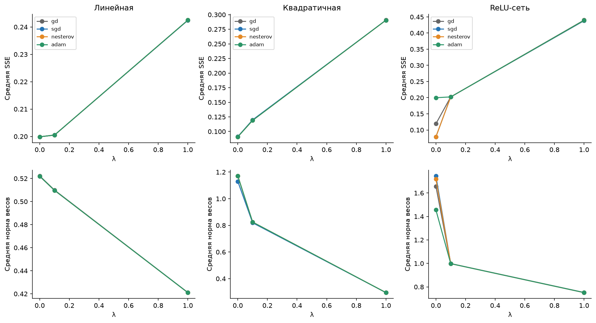

# Стохастический градиентный спуск и его модификации

Лабораторная работа 5. Выполнены задачи 1-4 и дополнительная задача 5*:
золотое сечение, обучение трёх моделей численным градиентным спуском,
минибатчи, импульс Нестерова, Adam и квадратичный штраф.

## Запуск

Требуется Python 3.10 или новее. Проверено на Python 3.11.8.
Команды из корня проекта в PowerShell:

```powershell
python -m venv .venv
.\.venv\Scripts\python.exe -m pip install -r Lab5/requirements.txt
.\.venv\Scripts\python.exe run_labs.py 5
```

Для воспроизведения с проверенными версиями вместо `requirements.txt`
можно установить `Lab5/requirements-lock.txt`.
В Linux / macOS используются `python3` и `./.venv/bin/python`.

Ноутбук уже выполнен: таблицы и графики доступны без повторного обучения.
Повторный запуск пересчитывает все **351 эксперимента** и обновляет выводы,
таблицы, рисунки и девять NPZ-моделей. Это занимает несколько минут.
Для интерактивной работы нужно выбрать ядро `.venv` и выполнить ячейки сверху вниз.
Рабочим каталогом может быть корень проекта или папка `Lab5`.

Отдельный пересчёт экспериментальных CSV и моделей, без обновления ноутбука и рисунков:

```powershell
.\.venv\Scripts\python.exe Lab5/experiments.py
```

Команда `python experiments.py` из папки `Lab5` делает то же самое.
Модуль читает `data.csv` рядом с собой независимо от рабочего каталога.
Флаг `--epochs` меняет лимит для отдельного исследовательского запуска;
сохранённый отчёт относится к полному протоколу из 3000 эпох.

## Методика

| Часть | Реализация |
|---|---|
| Задача 1 | Собственное золотое сечение, точность длины отрезка 1e-10; проверка единственности минимума |
| Задача 2 | Прямая, парабола и сеть с двумя скрытыми ReLU и ReLU на выходе; полный GD |
| Производные | Центральная разность, `h_j = 1e-5 * max(1, abs(theta_j))` |
| Потеря | Сумма квадратов ошибок SSE в исходной шкале данных |
| Задача 3 | SGD, батчи 1, 3, 6, 12; перемешивание без повторений внутри эпохи |
| Масштаб батча | `n / len(batch) * SSE_batch`, чтобы сохранить масштаб полной суммы |
| Задача 4 | Нестеров с множителем `(1-beta)` и предсказанной точкой из лекции; Adam с коррекцией смещения |
| Задача 5* | `SSE + lambda * sum(weights**2)`, lambda = 0, 0.1, 1; смещения не штрафуются |
| Seed | 2026, 2027, 2028; парные начальные точки и порядок батчей |
| Лимит | 3000 эпох; полный разностный градиент проверяется после каждой эпохи |
| Остановка | `max(abs(full_gradient)) < 1e-5`; отдельно сохраняется `converged` |
| Моменты | beta = 0.9, gamma = 0.999, epsilon Adam = 1e-8 |

Начальные скорости обучения:

| Модель | GD | SGD | Нестеров | Adam |
|---|---:|---:|---:|---:|
| Линейная | 0.02 | 0.005 | 0.01 | 0.02 |
| Квадратичная | 0.01 | 0.0025 | 0.01 | 0.02 |
| ReLU-сеть | 0.01 | 0.005 | 0.01 | 0.02 |

GD использует постоянную скорость; остальные методы -
`learning_rate / (1 + epoch / 300)`. Параметры полиномов инициализируются
равномерно из `[-0.1, 0.1]`. Сеть начинается с вектора
`[1, -0.35, -1, 1.3, 0.25, 0.25, 0.5]` и шума из `[-0.04, 0.04]`.
Порядок параметров сети: `w11, b11, w12, b12, w21, w22, b21`.

Заданы три модели, три штрафа, три seed и 13 сочетаний метода с батчем:
один полный GD и по четыре батча для SGD, Нестерова и Adam.
Итого `3 * 3 * 3 * 13 = 351` запуск.
Начальные шаги отличаются между методами, поэтому сравнение относится
к указанным настройкам, без заявления об оптимальности подбора.

## Результаты

Глобальный минимум заданной одномерной функции:
**z ≈ 0.38032153**, **f(z) ≈ 0.3286036575**.
В отчёте проверены знаки производной за пределами `[0.35, 0.65]`
и единственность её нуля внутри. Длина финального отрезка не равнозначна
точности координаты: сравнение почти равных значений функции ограничено float64.

Контрольные решения МНК дают SSE **0.19986636** для прямой и **0.09088204**
для параболы. При обучении эти решения не используются: все три модели
обучаются исключительно с численными производными.

Наименьшая средняя SSE среди конфигураций без штрафа:

| Модель | Метод | Батч | Средняя SSE | SD по трём seed |
|---|---|---:|---:|---:|
| Линейная | GD | 12 | 0.1998664 | менее 1e-12 |
| Квадратичная | GD | 12 | 0.0908820 | менее 1e-12 |
| ReLU-сеть | Нестеров | 3 | 0.0788007 | 0.0000020 |

Численный критерий остановки достигнут в **68 из 351** запусков.
У лучшей по средней SSE конфигурации сети он не достигнут ни в одном повторе.
Обычный GD для сети при seed=2028, напротив, выполнил критерий, но дал SSE
0.1998664: стационарность не гарантирует лучшей подгонки невыпуклой модели.

Актуальные показатели всех конфигураций приведены в выполненном ноутбуке
и [сводной таблице](results/summary.csv). Средние и стандартные отклонения
вычислены по трём seed. В [training.csv](results/training.csv) сохранены
конечные SSE, RMSE, R², регуляризованная цель, норма весов, норма градиента,
эпохи, обновления, счётчики разностных вычислений и выполнение критерия остановки.





## Использование модели

Из корня проекта:

```python
import numpy as np
from Lab5.optimization import predict_saved

prediction = predict_saved(
    'Lab5/models/relu_adam_b3_l0.npz',
    np.array([0.2, 0.8, 1.5]),
)
print(prediction)
```

Из папки `Lab5` импорт имеет вид `from optimization import predict_saved`,
а путь к архиву - `models/relu_adam_b3_l0.npz`.
Каждый архив содержит имя модели и её полный вектор параметров;
вход и выход имеют исходную шкалу таблицы задания.
NPZ-модели сохранены для Adam, B=3, seed=2026 и всех трёх штрафов.
Остальные параметры доступны в `results/parameters.csv` по `run_id`.

## Файлы

```text
Lab5/
├── Lab5.ipynb
├── README.md
├── data.csv
├── optimization.py
├── experiments.py
├── requirements.txt
├── requirements-lock.txt
├── tests/test_optimization.py
├── test-results.txt
├── models/                         # 9 архивов NPZ
├── figures/                        # 10 рисунков
└── results/
    ├── minimum.csv                 # Золотое сечение
    ├── unimodality.csv             # Проверка единственности минимума
    ├── settings.json               # Параметры и версии библиотек
    ├── training.csv                # Все 351 запуска
    ├── summary.csv                 # Средние, SD и диапазоны по seed
    ├── history.csv                 # Истории с шагом 20 эпох и конечные состояния
    ├── initial_parameters.csv      # Начальные параметры
    ├── parameters.csv              # Конечные параметры всех запусков
    ├── predictions.csv             # Прогнозы и остатки 12 точек
    ├── reference.csv               # Контрольные решения МНК и ridge
    ├── gd_control.csv              # Проверка GD против МНК
    ├── ridge_control.csv           # Проверка регуляризованного GD
    ├── difference_step_check.csv   # Чувствительность к шагу разностей
    └── regularization_comparison.csv
```

## Проверки и ограничения

```powershell
.\.venv\Scripts\python.exe -m unittest discover -s Lab5/tests -v
```

Из папки `Lab5`: `python -m unittest discover -s tests -v`.
Одиннадцать тестов проверяют золотое сечение на известной функции и задаче,
численные производные, три формулы моделей, выходную ReLU, L2 без смещений,
масштабирование батчей, покрытие эпохи, шаг GD, предсказанную точку Нестерова,
коррекцию Adam, обучение против МНК и ridge, остановку, воспроизводимость,
сохранение моделей и некорректные входы. Результат: `test-results.txt`.

При одинаковом числе эпох минибатчи дают разное число обновлений.
Графики показывают обе оси, а CSV содержит счётчик вычисления разностных
производных по объектам. Этот счётчик включает контроль полного градиента;
он не является измерением времени.

Полная SSE после отдельного стохастического шага может расти.
Значение `converged=False` сохраняется при исчерпании лимита даже при малой SSE.
В изломах ReLU центральная разность является секущей, поэтому критерий для сети
означает только численную стационарность при выбранном шаге разностей.
Результат сети зависит от начальной точки и локальных областей активации.

Регуляризация уменьшает предпочтительность больших весов, но качество
на новых наблюдениях в работе не оценивалось. Все ошибки относятся к исходным
12 точкам. Три seed показывают разброс конкретных запусков;
для общих статистических выводов этого недостаточно.
