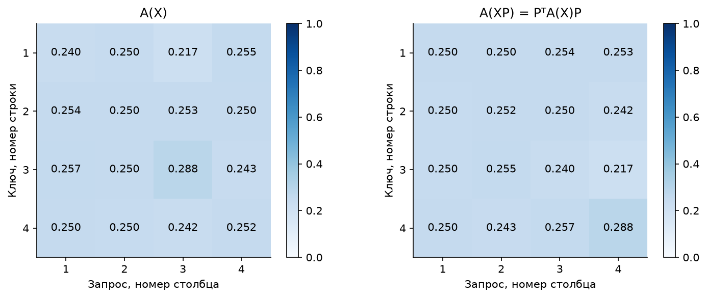
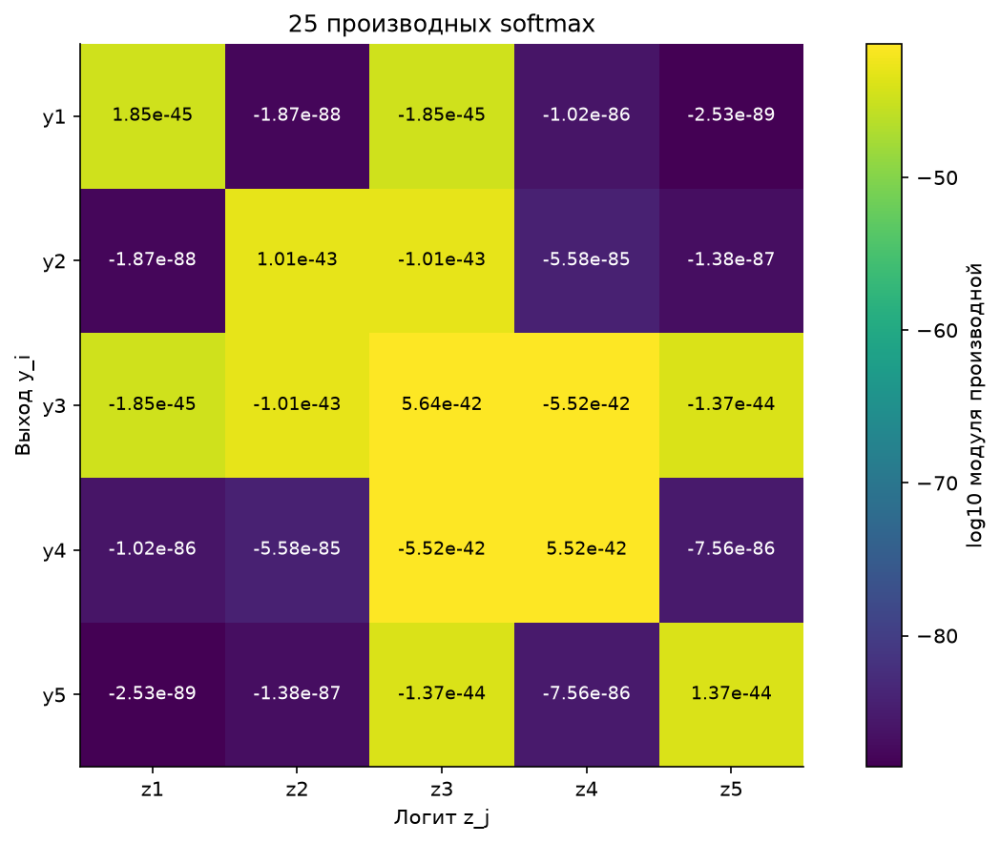

# Самовнимание и производные softmax

Выполнены все три задачи: подсчёт параметров, доказательство эквивариантности
к перестановкам входов и вычисление 25 производных softmax.

## Запуск

Команды из корня проекта в PowerShell:

```powershell
python -m venv .venv
.\.venv\Scripts\python.exe -m pip install -r Lab6/requirements.txt
.\.venv\Scripts\python.exe run_labs.py 6
```

Проверенные версии зависимостей сохранены в `requirements-lock.txt`.
В Linux / macOS используются `python3` и `./.venv/bin/python`.
Ноутбук уже выполнен и содержит таблицы, доказательства, выводы и три графика.
В VS Code или Jupyter выбирается ядро `.venv`, ячейки выполняются сверху вниз.
Рабочим каталогом может быть корень проекта или папка `Lab6`.

Отдельный пересчёт таблиц без обновления ноутбука и рисунков:

```powershell
.\.venv\Scripts\python.exe Lab6/experiments.py
```

## Задача 1. Параметры

Вход имеет размер `D x N`: каждый столбец является отдельным вектором.
Для значений, ключей и запросов используются три матрицы `D x D`
и три общих для всех позиций вектора смещений длины `D`.

| Величина | Число |
|---|---:|
| Веса QKV | `3D²` |
| Смещения QKV | `3D` |
| Все обучаемые параметры QKV | `3D(D+1)` |
| Вычисляемые коэффициенты матрицы внимания | `N²` |
| Дополнительные независимо обучаемые параметры этой матрицы | `0` |
| Перцептрон `DN → H → DN` | `2DNH + H + DN` |
| Перцептрон при явно принятом `H = DN` | `2(DN)² + 2DN` |

В условии не задана ширина скрытого слоя перцептрона, поэтому сначала
приведена общая формула. Для таблиц и графика используется частный случай `H=DN`.
Например, при `D=3, N=4` блок имеет 36 параметров QKV и 16 коэффициентов внимания;
перцептрон с `H=12` имеет 312 параметров.

Матрица внимания вычисляется заново для каждого входа. Её элементы
не прибавляются к числу обучаемых весов.

## Задача 2. Перестановки

Реализовано `Sa(X) = V @ softmax_columns(K.T @ Q / sqrt(D))`.
Каждый столбец матрицы внимания нормирован по всем ключам.
Доказательство в ноутбуке использует преобразования:

```text
Q(XP) = Q(X)P, K(XP) = K(X)P, V(XP) = V(X)P
S(XP) = P.T @ S(X) @ P
A(XP) = P.T @ A(X) @ P
Sa(XP) = Sa(X) @ P
```

Выполнено 120 численных проверок: все перестановки при `N=3,4` и 30 случайных
при `N=12`, с масштабированием и без него. Для проверок используются
относительный допуск `1e-5` и абсолютный `1e-7`. Seed равен 2026.



## Задача 3. Производные softmax

Используется вектор `z = [-3, 1, 100, 5, -1]` из задания:

```text
dy_i/dz_j = y_i * (delta_ij - y_j)
```

В ноутбуке и [jacobian.csv](results/jacobian.csv) приведены все 25 значений.
Строки соответствуют выходам `y_i`, столбцы - логитам `z_j`.

Вероятность третьего выхода очень близка к единице:
`1-y3 ≈ 5.6377e-42`. Float64 округляет её до `1.0`, поэтому прямое
вычисление `y3*(1-y3)` даёт ноль. Диагональ вычисляется устойчиво как
`y_i * sum(y_k, k != i)`, а внедиагональные элементы - как `-y_i*y_j`.
При этом **J33 ≈ 5.6377e-42** сохраняется.



Все производные очень малы: третий вход равен 100 и значительно больше
остальных. Поэтому третья вероятность близка к единице, а небольшие изменения
входов слабо влияют на результат. Диагональные производные положительны,
внедиагональные отрицательны.

Ответы выводятся и сохраняются с пятью значащими цифрами. Вычисления выполняются
обычными средствами NumPy. Для малых производных используется относительный
допуск `1e-5` и нулевой абсолютный допуск, чтобы не считать нулевую матрицу
правильным ответом. Отдельного требования к точности в задании нет.

## Проверки

```powershell
.\.venv\Scripts\python.exe -m unittest discover -s Lab6/tests -v
```

Из папки `Lab6`: `python -m unittest discover -s tests -v`.
Тесты проверяют размеры весов, подсчёт параметров перцептрона, вычисление
самовнимания и равенство при перестановке входов. Все 25 производных проверяются
подстановкой заданных чисел в формулу softmax и её производной.
